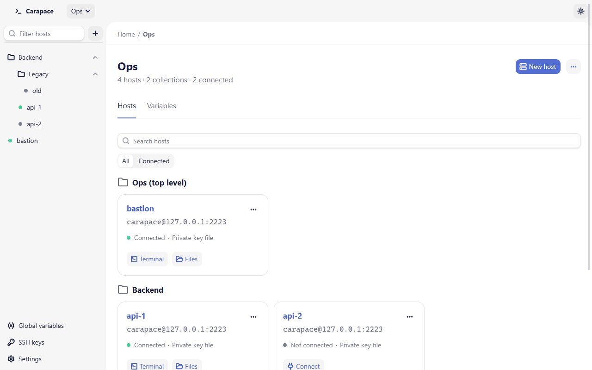

# Carapace

[](https://github.com/tbounsiar/carapace/actions/workflows/ci.yml)
[](https://github.com/tbounsiar/carapace/releases/latest)
[](LICENSE)

Carapace is a free, open source SSH and SFTP client for Windows, macOS and Linux: terminal tabs, a dual-pane file explorer and SSH key management in one window. Passwords and passphrases live in the operating system's keychain, and host keys are always verified.

<picture>
  <source media="(prefers-color-scheme: dark)" srcset="docs/images/overview-dark.png">
  
</picture>

## Download

Pick your operating system and processor. Each link downloads the latest release.

| OS | x64 (Intel / AMD) | ARM64 |
| - | - | - |
| **Windows** | [Installer (.exe)](https://github.com/tbounsiar/carapace/releases/latest/download/carapace-windows-x64-setup.exe) (recommended)<br>[MSI package](https://github.com/tbounsiar/carapace/releases/latest/download/carapace-windows-x64.msi) | [Installer (.exe)](https://github.com/tbounsiar/carapace/releases/latest/download/carapace-windows-arm64-setup.exe) |
| **macOS** | [Intel (.dmg)](https://github.com/tbounsiar/carapace/releases/latest/download/carapace-macos-x64.dmg) | [Apple Silicon (.dmg)](https://github.com/tbounsiar/carapace/releases/latest/download/carapace-macos-arm64.dmg) |
| **Linux** | [AppImage](https://github.com/tbounsiar/carapace/releases/latest/download/carapace-linux-x64.AppImage)<br>[.deb](https://github.com/tbounsiar/carapace/releases/latest/download/carapace-linux-x64.deb)<br>[.rpm](https://github.com/tbounsiar/carapace/releases/latest/download/carapace-linux-x64.rpm) | [AppImage](https://github.com/tbounsiar/carapace/releases/latest/download/carapace-linux-arm64.AppImage)<br>[.deb](https://github.com/tbounsiar/carapace/releases/latest/download/carapace-linux-arm64.deb)<br>[.rpm](https://github.com/tbounsiar/carapace/releases/latest/download/carapace-linux-arm64.rpm) |

Checksums of every file: [SHA256SUMS.txt](https://github.com/tbounsiar/carapace/releases/latest/download/SHA256SUMS.txt). Older versions are on the [Releases page](https://github.com/tbounsiar/carapace/releases).

<details>
<summary>Which one do I need?</summary>

- **Windows x64 or ARM64**: open Settings > System > About and look at "System type". "ARM-based processor" means ARM64; anything else is x64. The `.exe` installer is the usual choice; the `.msi` is for managed deployments.
- **macOS Apple Silicon or Intel**: open the Apple menu > About This Mac. "Chip: Apple M…" means Apple Silicon; "Processor: Intel…" means Intel.
- **Linux x64 or ARM64**: run `uname -m`. `x86_64` is x64, `aarch64` is ARM64.
- **Linux package**: `.deb` for Debian, Ubuntu and derivatives; `.rpm` for Fedora, RHEL, openSUSE and derivatives; the AppImage runs on most distributions without installing.

</details>

<details>
<summary>Verify a download</summary>

Compare the hash printed by the command with the line for the same file in `SHA256SUMS.txt`.

Windows (Command Prompt or PowerShell):

```
certutil -hashfile carapace-windows-x64-setup.exe SHA256
```

```powershell
Get-FileHash carapace-windows-x64-setup.exe -Algorithm SHA256
```

macOS:

```
shasum -a 256 carapace-macos-arm64.dmg
```

Linux, with `SHA256SUMS.txt` in the same folder as the download (checks every listed file that is present):

```
sha256sum -c --ignore-missing SHA256SUMS.txt
```

</details>

## Install

The builds are not code-signed, so each operating system warns on first launch. Step-by-step instructions and troubleshooting are in [docs/installation.md](docs/installation.md).

- **Windows**: run the installer. If SmartScreen shows "Windows protected your PC", choose **More info**, then **Run anyway**. Carapace is then in the Start menu.
- **macOS**: open the `.dmg` and drag Carapace to Applications. The app is only ad-hoc signed, so Gatekeeper blocks the first launch. Open System Settings > Privacy & Security, scroll to the message about Carapace and choose **Open Anyway**. From a terminal you can instead run `xattr -dr com.apple.quarantine /Applications/Carapace.app`.
- **Linux**:
  - AppImage: `chmod +x carapace-linux-x64.AppImage`, then run it. It needs FUSE 2 (`libfuse2`, or `libfuse2t64` on Ubuntu 24.04 and later).
  - Debian, Ubuntu: `sudo apt install ./carapace-linux-x64.deb`
  - Fedora, RHEL: `sudo dnf install ./carapace-linux-x64.rpm`

  Passwords and passphrases are stored through the Secret Service API, so a provider such as GNOME Keyring or KWallet must be running.

## Features

- **Home and projects.** Hosts live at Home or in a project, grouped in nested collections. Move them by drag and drop or with **Move to…**, with undo. Each scope has a dashboard with search and a connected-only filter.
- **Hosts as templates.** Any host field (hostname, port, username, key path) can use `${var}`. Variables are global or per project; a project variable wins over a global one. Passwords and passphrases come from secret variables or are asked when connecting. See [Variables](docs/variables.md).
- **Test connection** from the host dialog before saving.
- **Host key verification.** Unknown host keys are shown to you with their fingerprint for an explicit decision. A changed key blocks the connection and is never accepted silently.
- **Secrets in the OS keychain.** Passwords and key passphrases are stored in the system keychain and never sent back to the interface.
- **Authentication** by password, private key file (with or without passphrase) or SSH agent.
- **Terminal tabs.** Several terminals per host share one SSH connection with the file explorer.
- **Dual-pane SFTP.** Local and remote panes with navigation, sorting, hidden files, create, rename and delete.
- **Transfer queue.** Upload and download files and folders by selection or drag and drop, with progress, cancel, and overwrite, skip or keep both on conflicts.
- **Built-in editor** for remote text files up to 5 MiB, with syntax highlighting and detection of changes made on the server.
- **External editor.** Open a remote file in a local editor; each save is uploaded back, with conflict detection when the server copy changed. The **Edited files** page tracks every file being edited.
- **SSH keys.** Generate Ed25519 (default) or RSA 4096 keys with an optional passphrase, import existing OpenSSH keys, and deploy a public key to a host's `authorized_keys`.
- **Themes.** Light and dark, following the system by default.
- **Anonymous usage data**, shown before anything is sent and switchable per category. See [Privacy](#privacy).

## Documentation

- [Installation](docs/installation.md)
- [Getting started](docs/getting-started.md): Home, projects, collections, hosts, first connection
- [Variables](docs/variables.md)
- [SSH keys](docs/ssh-keys.md)
- [Terminal](docs/terminal.md)
- [Files and transfers](docs/file-transfer.md)
- [External editor](docs/external-editor.md)
- [Settings](docs/settings.md)
- [Security](docs/security.md)
- [FAQ and troubleshooting](docs/faq.md)

## Security model

- Secrets live only in the OS keychain: never in `data.json`, logs, error messages or messages to the interface.
- `known_hosts` verification is always on. There is no option to disable it.
- Private keys generated by Carapace are written owner-only (mode 600, or an owner-only ACL on Windows).

Details in [docs/security.md](docs/security.md). Report vulnerabilities as described in [SECURITY.md](SECURITY.md).

## Privacy

Your hosts, credentials and files stay on your machine. Carapace sends anonymous usage data, which it shows you on first launch before anything is sent and which you can turn off category by category; see [PRIVACY.md](PRIVACY.md) for exactly what is and is never sent.

## Where data lives

Carapace stores its data in `$CARAPACE_HOME`, `~/.carapace` by default (`%USERPROFILE%\.carapace` on Windows). The variable must be an absolute path or start with `~/`.

- `data.json`: projects, collections, hosts, variables and key paths. No secrets.
- `settings.toml`: app settings (theme, key type, terminal font size, external editor, usage data choices).
- `known_hosts`: the host keys you accepted. Carapace also reads `~/.ssh/known_hosts` but never writes to it.
- `keys/`: private keys generated by Carapace, with their `.pub` files. Imported keys stay where they are; Carapace only records their path.
- `edit/`: local copies of files open in an external editor, deleted when you stop editing.

Passwords and passphrases are in the OS keychain under the service `org.tbounsiar.carapace`.

## Build from source

Prerequisites on every OS: Node 26, Rust (stable) and the [Tauri prerequisites](https://tauri.app/start/prerequisites/) for your system.

- **Windows**: Microsoft C++ Build Tools and WebView2 (preinstalled on Windows 11).
- **macOS**: Xcode Command Line Tools (`xcode-select --install`).
- **Linux** (Debian, Ubuntu):

  ```
  sudo apt install libwebkit2gtk-4.1-dev libappindicator3-dev librsvg2-dev patchelf libssl-dev libdbus-1-dev
  ```

Then:

```
npm ci
npm run tauri dev      # run the app in development
npm run tauri build    # build the app and its installers
```

Bundles are written under `src-tauri/target/release/bundle/`: `nsis/` and `msi/` on Windows, `dmg/` and `macos/` on macOS, `appimage/`, `deb/` and `rpm/` on Linux.

## Development

```
npx ng test --watch=false                   # frontend tests
npm run lint                                # frontend lint
npx prettier --check src                    # formatting

cd src-tauri
cargo test
cargo clippy --all-targets -- -D warnings
cargo fmt --check
```

CI runs the Rust checks on Windows, macOS and Linux. End-to-end tests run against a disposable OpenSSH server in Docker; see [e2e/README.md](e2e/README.md). The end-to-end UI tests run on Windows only.

## Known limitations

- The host key is checked on the initial key exchange only; a different key presented on a later rekey is not detected.
- No keyboard-interactive authentication: servers that only allow it fail to authenticate. Password, public key and SSH agent are supported; agent use is untested on Windows.
- The terminal can stall the whole connection (other terminals, keepalive) while a very large output is still being displayed.
- All transfers of a host share one SFTP channel, so several large jobs on the same host slow each other down.
- Deploying a key reads and rewrites `authorized_keys`; a concurrent edit of that file can be lost.
- On Windows, downloaded files inherit the permissions of their folder.
- Interrupted transfers can leave hidden `.carapace-part` files behind; they are not cleaned up automatically.
- The host dialog cannot reference a secret variable that does not exist yet; create it in the variables editor first.
- RSA key signing relies on a crate with a known advisory (RUSTSEC-2023-0071) that has no upstream fix. Prefer Ed25519.
- Windows, macOS and Linux are supported. The end-to-end UI tests run on Windows only, so macOS and Linux get less testing of the full app.

## Contributing

Bug reports and pull requests are welcome; see [CONTRIBUTING.md](CONTRIBUTING.md). Report security issues privately as described in [SECURITY.md](SECURITY.md).

## License

[MIT](LICENSE)
