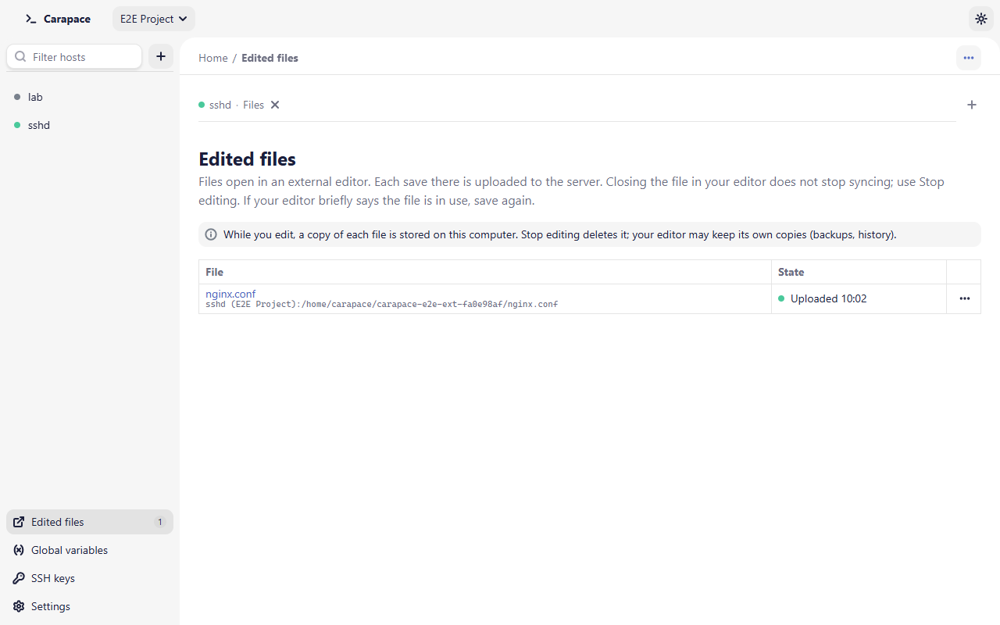
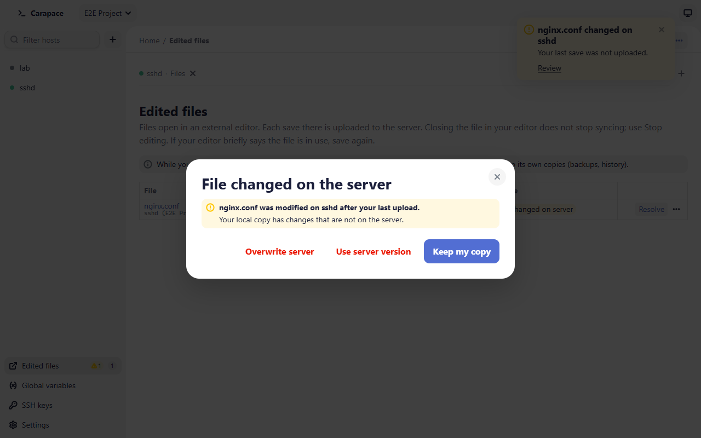

# External editor

Carapace can open a remote file in an editor installed on your computer (VS Code, Notepad++, TextEdit, gedit…). It downloads a copy, opens it in the editor, and uploads the copy each time you save there.

## Open a file

In the **Remote** pane of a Files tab, open the row's **…** menu and choose **Open in external editor**, or select the file and press Shift+Enter.

The first time, **Before you edit outside Carapace** explains what happens. Choose **Continue**; tick **Don't show this again** to skip it next time (it can be turned back on in [Settings](settings.md#external-editor)).

The file opens with your system's default app for its type, or with the app chosen in Settings. In the file list, an icon next to the file shows that it is being edited.

Some files ask for confirmation first:

- **Large files**: above 20 MiB, Carapace asks before downloading ("Each save in your editor uploads it again"). Files above 1 GiB cannot be opened this way.
- **Files that may hold secrets** (private keys, `.env` files and similar): **Copy a file that may hold secrets?** The copy is stored in clear text on this computer while you edit it, readable by your account only. Choose **Open anyway** to continue.
- **Scripts and programs**: with **System default**, Carapace refuses files your system would run instead of open in an editor (for example `.bat`, `.ps1`, `.sh`, `.py`, executables). Choose a **Custom app** in Settings to edit them.

## How saving works

Each time you save in the editor, Carapace waits for the file to be quiet for half a second, then uploads it. A save that does not change the content sends nothing. On Windows, while a save is being copied for upload, your editor may briefly say the file is in use; save again.

Before each upload Carapace checks that the server file has not changed since the last download or upload, and that the host is still the same server (same host key, address and user). Closing the file in your editor does not stop syncing: use **Stop editing**.

## Edited files

The **Edited files** page (sidebar, bottom; shown while at least one file is edited) lists every file with its host, path and state. A warning badge in the sidebar counts files that need attention.

| State | Meaning | What to do |
| - | - | - |
| Uploaded *time* / No changes | The server has your last save. | Nothing. |
| Uploading… | A save is being sent. | Wait. |
| Disconnected | The host is not connected; no unsent changes. | Nothing until you save. |
| Waiting for connection | You saved while the host was disconnected. | **Reconnect**: the changes are uploaded once connected. |
| Changed on server | The server file changed after your last upload (or was deleted). Your save is held. | **Resolve**, see below. |
| Upload failed | The upload failed (permission denied, disk full…). The message says why. | **Retry**. |
| Not uploaded (from *date*) | Carapace closed before your last changes reached the server. The copy was kept. | **Upload** or **Discard**. |

The **…** menu of a row has **Upload now**, **Open in external editor**, **Open in built-in editor**, **Show in folder** (the local copy), **Reconnect** *host*, **Discard** (for a kept copy) and **Stop editing**. Stopping a file whose changes are not uploaded asks first and deletes them.

### Conflicts

When the server file changed since your last upload, **File changed on the server** offers:

- **Overwrite server**: upload your copy over the server's version.
- **Use server version**: replace your local copy with the server's. Unsaved edits in your editor may be lost.
- **Keep my copy**: decide later; the file stays held in the "Changed on server" state.

If the server file was deleted, the choices are **Upload anyway** (create it again), **Stop editing** and **Keep my copy**.

If the host now points to another server (different host key, address or user), uploads are refused. Copy your changes out with **Show in folder**, then stop editing and open the file again from the current server.

## Where the copies live

Copies are stored in `edit/` inside the data folder (`~/.carapace/edit`), one folder per file, readable by your account only. They are marked as downloaded from the internet (Mark of the Web on Windows, quarantine attribute on macOS).

- **Stop editing** deletes the copy.
- When you quit, copies whose changes reached the server are deleted. If some changes are not uploaded, Carapace asks **Quit with unsaved changes?**; **Quit without saving** deletes them.
- If Carapace closes unexpectedly, copies with changes are kept and listed as **Not uploaded** at the next launch.
- Deleting a host, collection or project deletes the copies of its files. The confirmation lists them.

Your editor may keep its own copies (backups, history, swap files); Carapace does not manage those.
