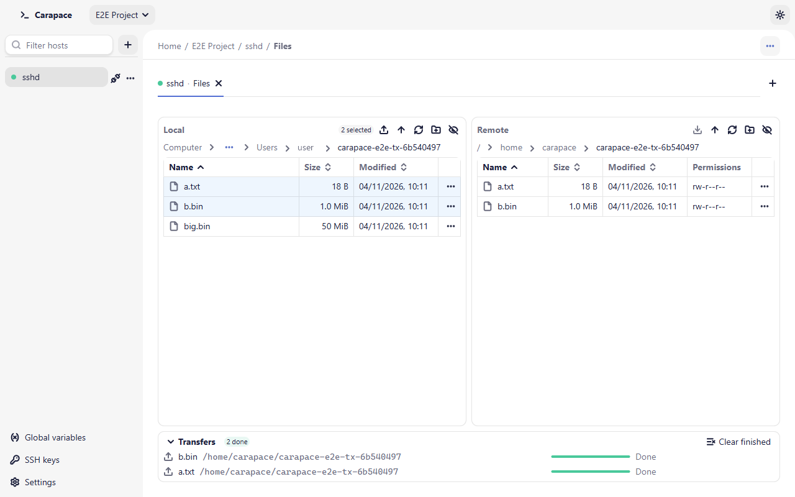
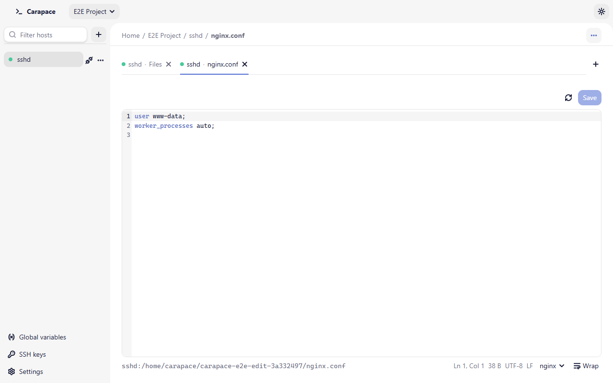

# Files and transfers

Open the file explorer with **Files** on a host card, the host page or the host's sidebar menu (**Browse files**). It opens as a tab with two panes: **Local** (this computer) on the left, **Remote** (the host, over SFTP) on the right. The remote pane starts in your home directory.

<picture>
  <source media="(prefers-color-scheme: dark)" srcset="images/file-transfer-dark.png">
  
</picture>

## Browsing

Each pane has a breadcrumb path and a toolbar: **Upload to remote** / **Download to local**, **Up one level**, **Refresh**, **New folder** and **Show hidden files**. On the local side, **Computer** lists the drives (Windows) or `/`. Click a column header (**Name**, **Size**, **Modified**, **Permissions**) to sort.

| Key | Action |
| - | - |
| Enter or double-click | Open the folder (or, on the remote side, the file in the built-in editor) |
| Shift+Enter | Remote file: open in the external editor |
| Backspace | Up one level |
| F2 | Rename |
| Delete | Delete the selection |
| Ctrl+A | Select all |
| Shift+F10 or Menu key | Open the row's menu |

Ctrl+click and Shift+click select several entries.

Right-click a row, or use its **…** button, for its menu: **Open** (folders), **Edit** and **Open in external editor** (remote files), **Upload to remote** / **Download to local**, **Copy path**, **Rename** and **Delete**. Right-clicking a row that is not selected selects it alone; right-clicking a selected row keeps the selection, and the menu then acts on all of it (**Copy paths**, transfer, **Delete** with one confirmation).

Right-click the empty area of a pane for **New folder**, **Refresh**, **Show hidden files**, **Select all** and **Copy folder path**.

Deleting a folder deletes its contents. Carapace refuses to delete a root or your home directory. Symbolic links are deleted as links; their target is untouched.

## Transfers

Select files or folders and choose **Upload to remote** or **Download to local**: they go to the folder open in the other pane. You can also drag the selection to the other pane, or onto a folder in it.

The **Transfers** panel at the bottom lists each job with its progress. Up to three jobs run at the same time per app; the others wait in the queue. **Cancel** (the × of a row) stops a job; **Clear finished** removes completed, failed and cancelled jobs from the list. Right-click a job for **Cancel**, **Retry** (failed or cancelled jobs), **Show in Local/Remote pane** and **Clear finished**. Transfers keep running when you switch tabs.

How files are written:

- Data goes first to a hidden temporary file (`.name.carapace-part`) next to the target, which is renamed into place when complete. A cancelled or failed transfer removes its temporary file; the target is either the old file or the complete new one.
- Folders are copied recursively. Symbolic links inside them are skipped, as are names that are not valid on the destination system (for example `CON` or `a:b` on Windows). Skipped entries are counted in the job.
- Uploaded files keep the mode of the source file (`0644` for files coming from Windows). An overwritten remote file keeps its previous mode.
- If the connection drops, its running and queued transfers fail. Reconnecting does not resume them; start them again.

### Conflicts

When a file already exists at the destination, the job pauses and shows **File already exists** with the destination path and the size and date of both files:

- **Overwrite** replaces the existing file.
- **Skip** leaves it and moves on.
- **Keep both** saves the incoming file as `name (1).ext` (or the next free number).

Tick **Apply to all remaining conflicts in this transfer** to answer once for the whole job. Folders that already exist are merged, not replaced.

## Built-in editor

**Edit** (or Enter) on a remote file opens it in an editor tab. It handles UTF-8 text files up to 5 MiB.

- **Save** (Ctrl+S) writes the file back. Line endings (LF or CRLF) and a byte order mark are kept as they were.
- **Reload from server** discards your changes and reads the file again.
- **Wrap** (Alt+Z) toggles line wrapping. The language menu sets syntax highlighting: Plain text, Shell, YAML, JSON, INI / properties, nginx, Dockerfile.
- A **Read-only** badge means the file has no write permission.
- If the file was changed on the server since you opened it, saving asks whether to **Overwrite** it or **Reload from server**. If it was deleted, you can **Save anyway** to create it again.
- If the connection is lost, your text stays in the tab; **Reconnect**, then save.

Closing a tab or quitting with unsaved changes asks first. For larger files, binary files or your own editor, use the [external editor](external-editor.md).
