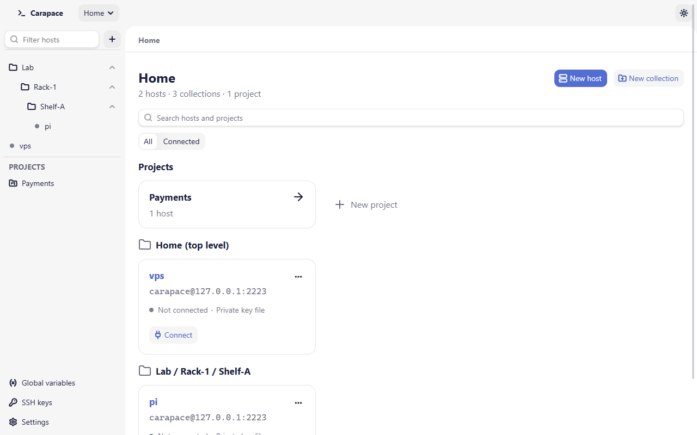
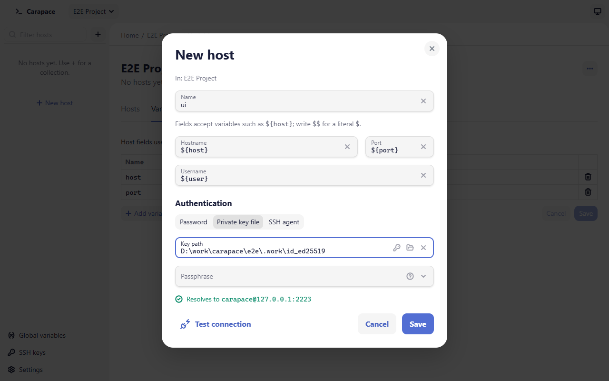
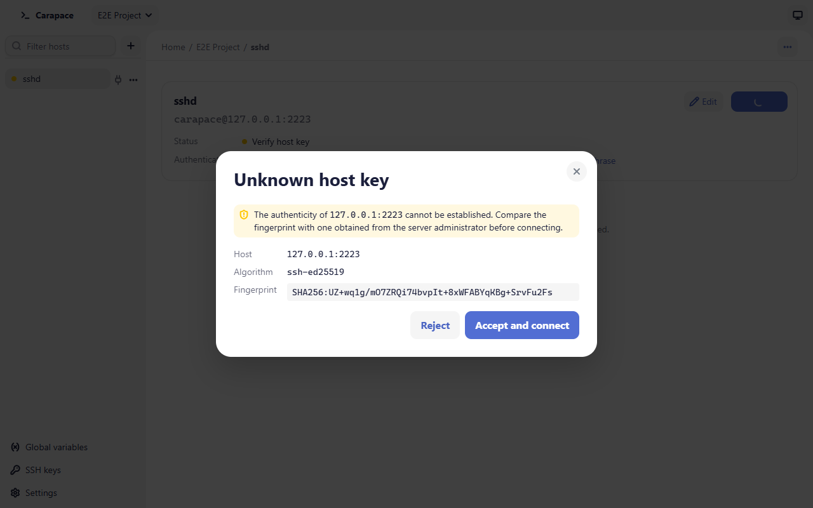

# Getting started

This page walks through organizing hosts and opening a first connection.

## The window

- **Header**: the project selector (Home or a project) and the theme menu.
- **Sidebar**: the hosts of the current scope as a tree, a **Filter hosts** box (Ctrl+K) and a **+** button with **New host**, **New collection** and **New project**. At the bottom: **Edited files** (only while files are open in an external editor), **Global variables**, **SSH keys** and **Settings**.
- **Main area**: a location bar (Home / project / host / tab), the open tabs, and the current page.



## Home, projects and collections

**Home** is the default scope. Hosts at Home use [global variables](variables.md) only.

A **project** groups hosts that share variables: for example one project per customer or per application. A project host uses the project's variables first, then the global ones. Create a project with **New project** in the sidebar **+** menu, on the Home page, or from the project selector (**New project…**). Switch between Home and projects with the project selector in the header.

**Collections** are folders. They can be nested and exist both at Home and inside projects. They only organize the tree; they do not change how variables resolve.

Each scope has a dashboard: the host cards grouped by collection, a search box (Ctrl+F) that matches host names, addresses and collection names, and an **All** / **Connected** filter. A project's page also has a **Variables** tab.

### Moving and deleting

Drag a host or a collection in the sidebar, or use **Move to…** in its **…** menu. A move within the same scope can be undone from the notification.

Moving a host to another scope (Home to a project, or between projects) changes the variables it resolves with. Carapace warns before the move: the host's open connections are closed and its saved passwords are forgotten, and the warning lists variables that are not defined in the destination.

Deleting a collection or a project deletes everything in it. The confirmation says how many hosts and collections that is. Saved secrets of the deleted hosts are removed from the keychain.

## Add a host

Choose **New host** (sidebar **+**, a dashboard, or **New host here** in a collection's menu). The dialog shows where the host goes ("In: …").



- **Name**: unique within the scope.
- **Hostname**, **Port**, **Username**: plain values or [variables](variables.md) such as `${host}`. Write `$$` for a literal `$`. Below the fields, the dialog shows what the host resolves to ("Resolves to user@host:port") or which variables are missing.
- **Authentication**:
  - **Password**: pick a secret variable, or leave **Ask when connecting**.
  - **Private key file**: a key path (for example `~/.ssh/id_ed25519`). The key button picks a key registered in [SSH keys](ssh-keys.md); the folder button browses for a file. **Passphrase**: a secret variable, or **Ask when connecting**. It is only used for an encrypted key.
  - **SSH agent**: keys offered by the running agent (`SSH_AUTH_SOCK` on macOS and Linux; the OpenSSH agent service or Pageant on Windows).

**Test connection** connects with the current values, reports the result and disconnects. It does not save anything; a password typed for a test is not remembered.

## Connect

Connect from the plug icon next to a host in the sidebar, the **Connect** button on its card, or the host page. Opening a **Terminal** or **Files** connects first if needed. A green dot marks a connected host.

### The host key prompt

The first time you connect to a server, Carapace does not know its host key and shows **Unknown host key** with the host, the key algorithm and its SHA256 fingerprint.



Compare the fingerprint with one you got from the server administrator, or from the server itself through a trusted channel. On the server, this prints the fingerprints:

```
for f in /etc/ssh/ssh_host_*_key.pub; do ssh-keygen -lf "$f"; done
```

Choose **Accept and connect** if it matches. The key is written to Carapace's own `known_hosts` file, and later connections are silent. **Reject** stops the connection. Hosts already in your `~/.ssh/known_hosts` are recognized without a prompt.

If a known server presents a different key, the connection is refused and **Host key has changed** appears. See [Security](security.md#host-key-verification) before choosing **Replace stored key**.

### Passwords and passphrases

When a password or passphrase is needed and none is stored, Carapace asks for it. Tick **Remember in the system keychain** to save it for this host. It is stored only after the server accepted it.

A saved secret is tied to the host's resolved address (user, hostname, port) or key path. If you change those, the saved secret is no longer used and Carapace asks again. To remove it yourself, open the host page and choose **Forget saved password** (or passphrase).

## The host page

Select a host in the sidebar to open its page: address, status, authentication, **Edit**, **Connect** / **Disconnect**, and its open tabs. **New terminal** and **Files** open tabs for that host.

Next: [Terminal](terminal.md), [Files and transfers](file-transfer.md).
