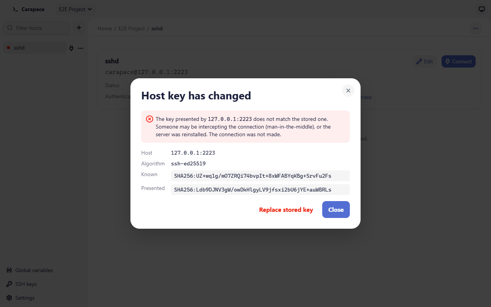

# Security

This page describes how Carapace stores secrets, verifies servers and protects key files. To report a vulnerability, see [SECURITY.md](../SECURITY.md).

## Secrets and the system keychain

Passwords and passphrases are stored only in the operating system's keychain, under the service name `org.tbounsiar.carapace`:

| OS | Keychain |
| - | - |
| Windows | Credential Manager (Windows Credentials) |
| macOS | Keychain (your default keychain, usually the login keychain) |
| Linux | Secret Service API: GNOME Keyring, KWallet or another provider, which must be running and unlocked |

Three kinds of entries are stored:

- **Secret variable values**, global or per project.
- **Saved connection secrets**: a password or passphrase you typed when connecting with **Remember in the system keychain** ticked. It is saved only after the server accepted it, and it is tied to the host's resolved `user@hostname:port` (password) or key path (passphrase). If those change, the entry is not used and is deleted.
- **Remembered key passphrases**, set on the SSH keys page. One is used only for a key file whose fingerprint matches the registered key, so a different file placed at the same path never receives it.

A secret is never written to `data.json` or `settings.toml`, to logs or to error messages, and is never sent to the app's interface: the interface only learns whether a value is set. Error messages may name a variable, never its value.

Secrets are removed from the keychain when you delete the host, project, variable or key they belong to, when you use **Forget saved password** / **Forget passphrase**, and when a host moves to another scope. A saved secret the server refuses is deleted. A password typed for **Test connection** is never stored.

Plain variables cannot be used in password or passphrase fields, and secret variables cannot be used in hostname, port, username or key path fields, which are displayed and logged.

## Host key verification

Every connection checks the server's host key. There is no option to turn this off.

Carapace looks the host up in its own `known_hosts` file (in the data folder) first, then in your `~/.ssh/known_hosts`, which it reads but never writes. Plain and hashed (`|1|…`) entries are supported, on `host` or `[host]:port`. Keys listed under `@revoked` are refused.

- **Unknown host**: Carapace shows the host, the key algorithm and the SHA256 fingerprint and waits for your decision (up to two minutes). **Accept and connect** adds the key to Carapace's `known_hosts`; **Reject** or no answer stops the connection.
- **Changed key**: if the host has a known key and the server presents a different one, the connection is refused and **Host key has changed** shows the known and presented fingerprints. This happens when a server is reinstalled or its keys are rotated, and also when someone intercepts the connection. Check the new fingerprint with the server administrator before choosing **Replace stored key**, then connect again. **Close** leaves everything as it was.
- If a `known_hosts` file cannot be read (permissions, a folder in its place), the connection fails instead of treating the host as unknown.

Limitation: the host key is checked on the first key exchange of a connection only. A different key presented on a later rekey is not detected.

## Key files

- Private keys generated by Carapace are created readable and writable by you only: mode `600` on macOS and Linux, an access list granting only your account on Windows. The default `keys/` folder is owner-only too.
- Existing files are never overwritten when generating.
- The SSH keys page shows a warning when a key file can be read by other users.
- Carapace reads key files only from local drives; paths to network shares are refused.
- Deleting key files is only possible for keys Carapace generated, and only if the files still hold that key.

## Files you edit

Copies of files opened in an [external editor](external-editor.md) are stored in owner-only folders in the data folder and deleted when you stop editing. Before each upload Carapace checks that the host still presents the host key and address it had when the file was opened, so a save is never sent to a different server.

## What Carapace never stores or sends

- Passwords and passphrases anywhere outside the keychain.
- Private keys outside the file you chose or generated; keys are not copied on import.
- Your servers, credentials or files to any third party. Carapace has no account and no server; connections go directly from your computer to your hosts.

Anonymous usage data, on by default and shown before anything is sent at first launch, can be turned off category by category; it is described in [PRIVACY.md](../PRIVACY.md).
