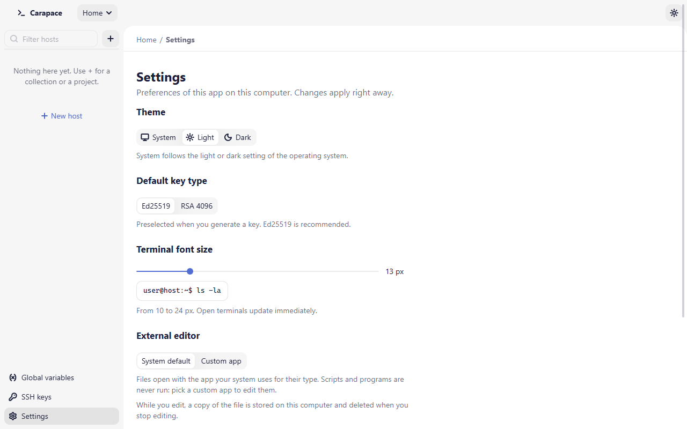

# Settings

Open **Settings** at the bottom of the sidebar. Changes apply right away; there is no Save button.

## Theme

**System** (default) follows the light or dark setting of the operating system; **Light** and **Dark** force one. The sun / moon / monitor button in the header switches the theme too.

## Language

**System** (default) shows Carapace in French when the operating system language is French, in English otherwise; **English** and **Français** force one. The change applies at once, without a restart. Native file dialogs follow the operating system language.

## Default key type

**Ed25519** (default) or **RSA 4096**: the type preselected when you [generate a key](ssh-keys.md#generate-a-key). You can still change it in the dialog.

## Terminal font size

From 10 to 24 px, 13 px by default. Open terminals update immediately.

## External editor

How [Open in external editor](external-editor.md) opens files:

- **System default**: the app your system uses for the file's type. Files the system would run (scripts, programs) are refused.
- **Custom app**: choose the editor's program file with **Browse…**. The file to edit is passed as its only argument, and any file type can be opened. Shells, terminals, script interpreters and generic openers are refused, because they would run the file instead of editing it. On macOS you can pick an `.app` bundle. **Clear** removes the choice; until an app is chosen, files open with the system default.

**Show a notice before opening a file outside Carapace** turns the first-use explanation back on or off.

## Privacy

Four switches control the anonymous usage data and crash reports, one per category. All four are on by default:

- **Launch count**: one event when Carapace starts.
- **Feature usage**: which features you use, with setup sizes as ranges.
- **Connection results**: whether connections and connection tests succeed, with the error code.
- **Crash reports**: if Carapace crashes, the crash type, the app area and, in its own code, the source line; never the message or any path.

Turn any of them off here at any time. The same switches are shown at first launch, before anything is sent; **Save choices** keeps them as shown. **View recent events** lists the events and crash reports of the current session with everything they carry; **How analytics work** opens the privacy page. See [PRIVACY.md](../PRIVACY.md) for exactly what is and is never sent.

If the `DO_NOT_TRACK` environment variable is set (any value other than empty, `0` or `false`), the switches are off and disabled and nothing is sent.

Only official release builds can send usage data. Development builds and your own builds from source never do; the page says so ("This build does not send usage data").

## Data

**Export…** saves your projects, collections, hosts, variables and registered key paths to a JSON file: everything, Home only, or one project. For a project you can include the global variables and SSH keys its hosts use. **Import…** reads such a file and shows what would change before anything is written. The same actions are in the **…** menu of Home and of each project, and an empty Home offers **Import from a file**.

The file never contains secret values: a secret variable is exported by name only, saved passwords and key files are not included. Set the secrets again on the computer you import to. The file does list your hosts and user names, so keep it private.

When importing, choose what happens to items that already exist:

- **Merge** adds new items, updates matching ones and keeps everything else.
- **Replace** makes the imported part of your data match the file exactly, deleting what the file does not have. It asks for confirmation first.
- **Keep both** imports matching items as copies named "(imported)".

The preview lists every change, the hosts with an open connection that are affected, the secrets you still need to set and the key files not found on this computer. If an import would make a saved secret go to a different server, for example because a host's address or a variable changes, it says which, and you must tick **I trust these servers** before importing. Key files outside your home folder are not checked: add those keys by hand in SSH keys.

Your current data is backed up before every import (`backups/` in the data folder), and **Undo import** in the summary restores it. Secret values deleted by a Replace cannot be restored.

## Where settings are stored

All settings on this page are stored in `settings.toml` in the [data folder](faq.md#where-is-my-data). It is a plain text file you can read, back up or edit by hand while Carapace is closed.
