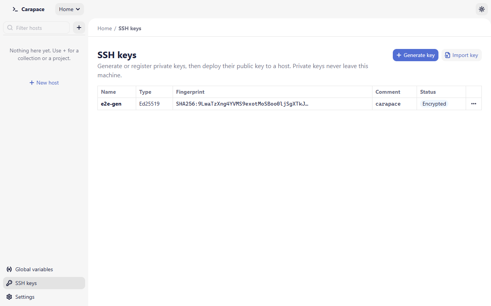

# SSH keys

The **SSH keys** page (sidebar, bottom) lists the private keys Carapace knows about. Private keys never leave your machine; only the public key is copied or deployed.

Each key shows its type, SHA256 fingerprint, comment and badges:

- **Encrypted**: the private key is protected by a passphrase.
- **Passphrase saved**: the passphrase is in the system keychain.
- **External**: an imported key; the file stays where it was.
- **Custom folder**: a generated key stored outside the default folder.
- A warning icon when the key file can be read by other users of the computer, or is missing.

## Generate a key

Choose **Generate key**.

- **Type**: **Ed25519** (recommended, the default) or **RSA 4096** for servers without Ed25519 support. Generating an RSA key takes a few seconds. The preselected type can be changed in [Settings](settings.md).
- **Name**: how the key appears in Carapace.
- **Folder**: by default the app's `keys/` folder (`~/.carapace/keys`). Use the folder button to choose another existing folder; Carapace warns if other users can write to it.
- **File name**: letters, digits, `.`, `_` and `-`. The public key is saved next to it with a `.pub` suffix. Existing files are never overwritten.
- **Comment**: written at the end of the public key, often `user@machine`.
- **Passphrase (optional)** and **Confirm passphrase**: encrypt the private key. Recommended.
- **Remember passphrase in the system keychain**: Carapace then decrypts the key when connecting without asking you.

The private key file is created readable by you only (mode 600 on macOS and Linux, an owner-only access list on Windows). Keys are written in OpenSSH format, so `ssh` and other tools can use them too.

## Import a key

Choose **Import key** to register a key you already have, for example `~/.ssh/id_ed25519`. The file is not copied: it stays where it is and Carapace records its path.

- Only private keys in the OpenSSH format are accepted (the format `ssh-keygen` writes by default). PuTTY `.ppk` and PEM / PKCS#8 files are refused; convert them with `ssh-keygen` or PuTTYgen first.
- Ed25519 and RSA keys of at least 2048 bits are supported.
- **Passphrase (optional)** is only needed to remember the passphrase of an encrypted key. A wrong passphrase is refused.

The host dialog also offers **Register this key** when a host uses a key path that is not in the list.

## Use a key for a host

In the host dialog, choose **Private key file** and either type the path or use the key button to pick a registered key. When connecting, Carapace reads the file and, if it is encrypted, uses in order: a passphrase you type, the host's secret variable, the passphrase saved for that host, the passphrase remembered for the registered key, or asks.

## Deploy a public key

**Deploy to host...** in a key's **…** menu appends its public key to `~/.ssh/authorized_keys` on a host, so you can log in with the key afterwards.

1. Choose the **Host**. Carapace connects first, as usual (for example with the password).
2. Leave **Use this key for the host** ticked to switch the host's authentication to this key.
3. Choose **Deploy**.

Carapace creates `~/.ssh` (mode 700) and `authorized_keys` (mode 600) if they are missing. If the key is already there, nothing is added. If it is only present on lines with options (such as `restrict` or `command=`), nothing is changed and Carapace tells you, so restrictions you set are not widened.

Replacing an existing `authorized_keys` needs a server that supports atomic rename (`posix-rename@openssh.com`, present in OpenSSH). Other servers get an error instead of a non-atomic rewrite.

## Other actions

- **Copy public key**: the `ssh-ed25519 AAAA… comment` line, ready to paste into a server or a Git hosting service.
- **Rename**: changes the name in Carapace only.
- **Forget passphrase**: removes the remembered passphrase from the keychain.
- **Delete**: removes the key from the list and forgets its passphrase. For a key generated by Carapace, **Also delete the key files** removes the private and `.pub` files too; servers that trust only that key can then no longer be reached with it. Imported key files are never deleted.

## SSH agent

Carapace does not manage agent keys. To use an agent, start it and add your keys with `ssh-add` as usual, then set the host's authentication to **SSH agent**. On Windows, Carapace uses the OpenSSH Authentication Agent service, then Pageant. Agent use on Windows has had less testing.
