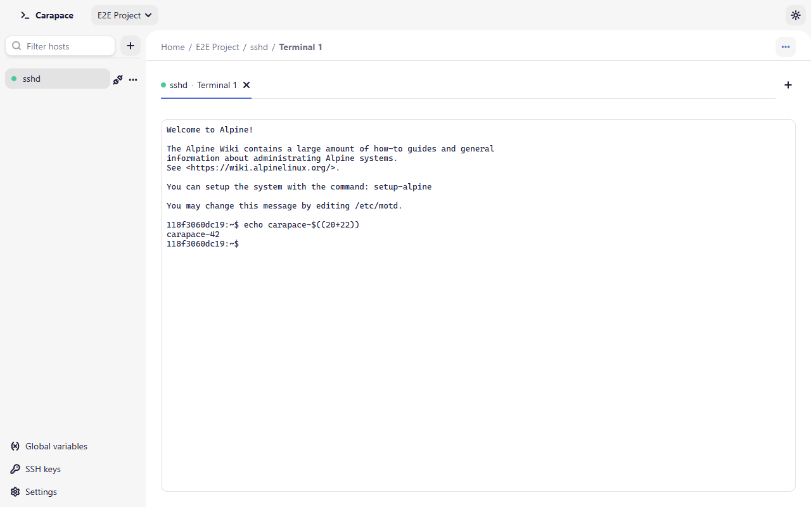

# Terminal

Open a terminal with **Terminal** on a host card, **New terminal** on the host page or in the host's sidebar menu, or the **+** at the end of the tab strip (new terminal on the host of the current tab). Carapace connects first if needed.

All terminals and the file explorer of a host share one SSH connection, so opening another tab does not log in again. A host can have up to 32 terminals open at once.

Each terminal and the file explorer use one session on that connection. When the server refuses another session (OpenSSH `MaxSessions`, 10 by default; Dropbear's channel limit), Carapace opens up to four extra connections to the same host. It checks that the server presents the same host key as the first connection. It reuses only credentials that need no input: a saved password or passphrase, a secret variable, an unencrypted key or the SSH agent. If you typed the password without saving it, the new tab fails with "the server allows no more sessions on this connection": close another tab of this host, or raise `MaxSessions` on the server.

The terminal is xterm-compatible (`TERM=xterm-256color`), resizes with the window and keeps 10,000 lines of scrollback. The font size is set in [Settings](settings.md) and applies to open terminals immediately.

## Copy and paste

Right-click in a terminal (or press the Menu key) for **Copy**, **Paste**, **Select all** and **Clear scrollback**. Clear scrollback only clears the screen history in Carapace; nothing is sent to the shell.

| Shortcut | Action |
| - | - |
| Ctrl+Shift+C | Copy the selection |
| Ctrl+Shift+V | Paste |
| Ctrl+Shift+A | Select all |

On macOS these are Cmd+C, Cmd+V and Cmd+A. Ctrl+C is not copy: the shell receives it, as an interrupt.

When a program uses the mouse (tmux, htop, vim with `mouse=a`), a right click goes to that program; Shift+right-click opens the menu.

Pasted text has its control characters removed, except tabs and line breaks, so a copied escape sequence cannot run commands on its own.

## Tabs

Terminal, file and editor tabs of every host share one tab strip. Each tab shows the collections, the host name and the tab, for example `clavis / production · Terminal 1`, and a status dot; a warning icon means the connection was lost. Long names are cut with an ellipsis; hover a tab for its full location. When tabs do not fit, the extra ones go into a **More** menu. Right-click a tab (or Shift+F10) for its menu, which includes **Close other tabs** and closing the tabs of a host.

| Shortcut | Action |
| - | - |
| Ctrl+Tab / Ctrl+Shift+Tab | Next / previous tab |
| Ctrl+1 … Ctrl+8 | Go to tab 1 to 8 |
| Ctrl+9 | Go to the last tab |
| Ctrl+Shift+T | New terminal on the current host |
| Ctrl+Shift+W | Close the current tab |
| Ctrl+W | Close the current tab, except in a terminal, where the shell receives it |

These use Ctrl on macOS too. Other combinations, such as Ctrl+C, Ctrl+R or Ctrl+K inside a terminal, go to the shell.

## When a terminal ends

A banner explains why: **The shell exited.**, **The terminal was closed.** or **The connection was lost.** Choose **Reopen** to start a new shell in the same tab; the previous output stays above it. If the connection was lost, Reopen connects again.

**Disconnect** on a host closes its terminals, its file explorer and its running transfers.
