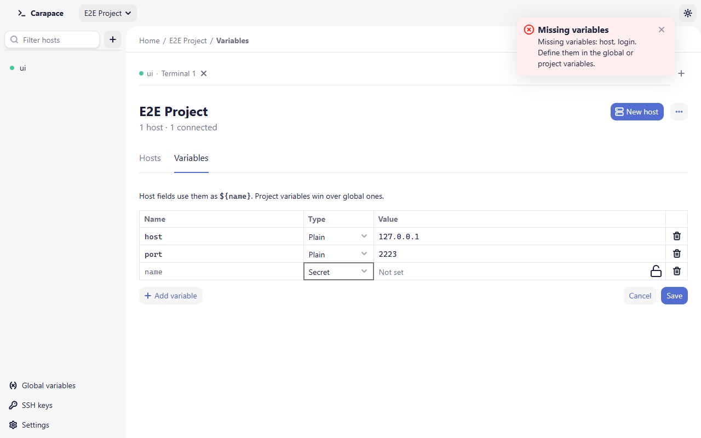

# Variables

Variables let several hosts share values, such as a jump hostname, a username or a password, and change them in one place.

## Global and project variables

- **Global variables** (sidebar, bottom) apply everywhere.
- **Project variables** apply to the hosts of one project. Open them from the project's **Variables** tab or **Project variables** in the project selector.

A project host looks up a name in its project first, then in the global variables: **a project variable wins over a global one** with the same name. A host at Home uses global variables only.

Edit the table, then **Save**. **Cancel** drops unsaved changes; leaving the page with unsaved changes asks first.

## Using variables in hosts

In the host dialog, the **Hostname**, **Port**, **Username** and **Key path** fields accept `${name}` anywhere in the text:

| Field | Value | Variables | Result |
| - | - | - | - |
| Hostname | `${env}.db.example.com` | `env` = `staging` | `staging.db.example.com` |
| Username | `${user}` | `user` = `deploy` | `deploy` |
| Key path | `~/.ssh/${key}` | `key` = `id_ed25519` | `~/.ssh/id_ed25519` |

- Write `$$` for a literal `$`. Any other `$` is kept as is, but `${` must start a valid reference.
- Names start with a letter or `_`, then letters, digits, `_`, `.` or `-`, up to 64 characters. Lookup is case-sensitive, but two variables in one scope cannot differ only by case.
- Values are inserted as they are; a value that contains `${other}` is not expanded again.

The host dialog previews the result ("Resolves to …") as you type.

## Secret variables

Set the **Type** of a variable to **Secret** for passwords and passphrases. Its value is stored in the system keychain, never in `config.json`, and is never shown again: the field shows **Set. Type to replace** or **Not set**, with a lock icon.

- The host's **Password** and **Passphrase** fields only take a secret variable, picked from a list. The other fields only take plain variables, because they are displayed and appear in messages.
- The variable must exist before a host can pick it. Create it here first.
- Renaming a secret variable drops its stored value. The editor warns you; type the value again.
- If a secret variable has no value when you connect, Carapace uses the password saved for that host, if any, or asks.

## Missing variables

If a host references a variable that is not defined in its scope, the connection is not attempted and a notification lists the names:

> **Missing variables**
> Missing variables: host, login. Define them in the global or project variables.

The host card and the host page show the same list in place of the address. Define the variables in the project or in the global variables, or edit the host.
